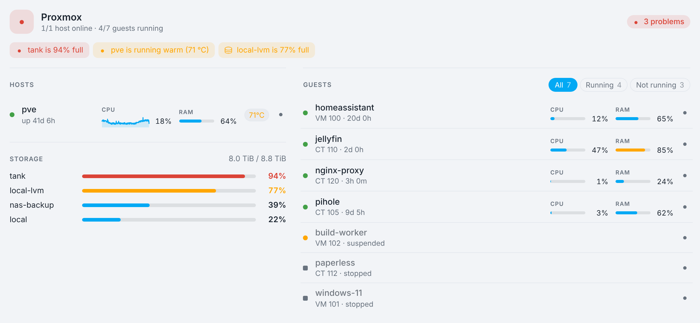
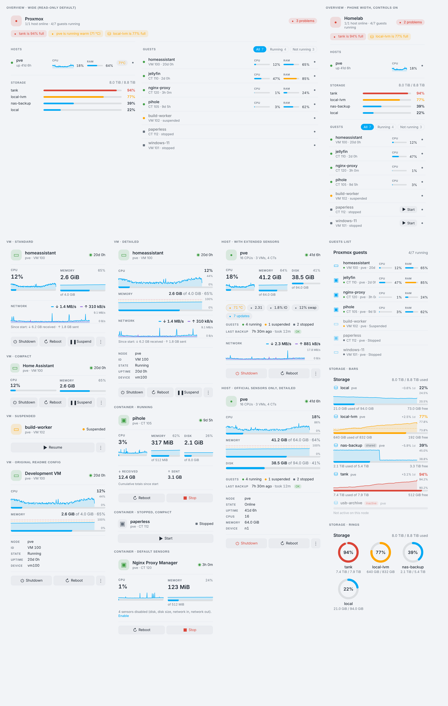
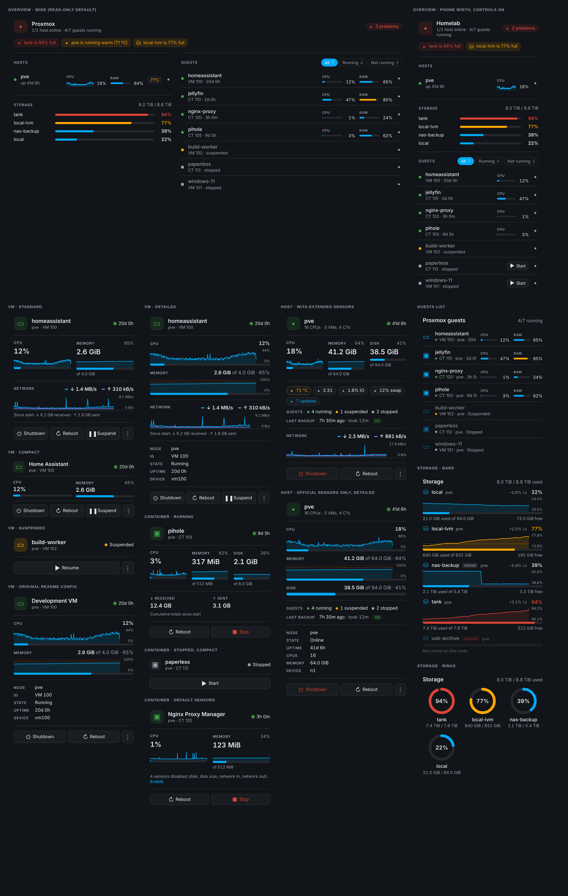

# Proxmox Cards (VMs, containers, storage)

A set of Home Assistant cards for Proxmox, all in one JavaScript file:

| Card | What it shows |
|---|---|
| `custom:proxmox-vm-card` | One QEMU VM. This is a rewrite of [chsegala/proxmox-cards-for-home-assistant](https://github.com/chsegala/proxmox-cards-for-home-assistant), and your existing YAML for that card works unchanged |
| `custom:proxmox-overview-card` | **Your whole Proxmox instance on one card:** problems, hosts, storage and every guest. Tap a row to expand it into the full card |
| `custom:proxmox-node-card` | A Proxmox **host** (node): CPU, memory and root disk with graphs, a guest summary, the last backup, optional health sensors, and Shutdown/Reboot/bulk guest actions |
| `custom:proxmox-guest-card` | The same card for an **LXC container**. It also accepts VMs |
| `custom:proxmox-guests-card` | A compact list of every container and VM, with status, uptime, CPU and RAM |
| `custom:proxmox-storage-card` | Storage pools shown as usage bars with a full-width usage history chart, or as ring gauges |





The cards read their data from the official Home Assistant **Proxmox VE** integration (`proxmoxve`).
They never talk to Proxmox directly. The file has no dependencies and needs no build step.

## Install

### Manual
1. Download [`proxmox-extra-cards.js`](https://raw.githubusercontent.com/ekallias/playground/main/proxmox-cards/proxmox-extra-cards.js)
   and copy it to `/config/www/proxmox-extra-cards/`.
2. **Settings → Dashboards → ⋮ → Resources → Add resource**
   URL `/local/proxmox-extra-cards/proxmox-extra-cards.js?v=0.6.0`, type **JavaScript module**.
   Change the `?v=` number whenever you update the file, so browsers load the new copy.
3. Hard-refresh the browser.

### HACS
HACS only installs from the root of a repository, so it can't install the cards from this folder of the
playground repo. To install through HACS, copy this folder to the root of its own repository. `hacs.json` is
already included. Then add that repository under **HACS → ⋮ → Custom repositories**, with type **Dashboard**.

### Switching from the original VM card
1. Remove the old resource (`/hacsfiles/proxmox-cards-for-home-assistant/proxmox-vm-card.js` or your manual copy).
   Two resources can't both define `proxmox-vm-card`. If both are loaded, whichever loads first wins, and the
   browser console shows a warning.
2. Add this resource as described above and hard-refresh.
3. You don't need to change your dashboards: every `type: custom:proxmox-vm-card` card keeps its config.

## VM and container cards

`proxmox-vm-card` and `proxmox-guest-card` are the same card. The only difference is that the VM card
accepts VMs only, exactly like the original.

```yaml
type: custom:proxmox-guest-card     # or custom:proxmox-vm-card
device: <device id>                 # pick it in the editor
title: Pi-hole                      # optional
icon: mdi:pi-hole                   # optional
layout: standard                    # compact | standard | detailed
state_accent: true                  # colour the icon and status dot by state
metrics:                            # hide individual metrics
  network: false
progress_bars:                      # true / false, or per metric
  disk: false
memory_percentage: true
disk_percentage: true
actions:                            # hide individual controls
  suspend: false
confirm: [shutdown, reboot, force-stop, suspend]   # the default; [] = never ask
show_action_status: true            # "Reboot sent. Waiting for Proxmox…"
tap_action:    { action: more-info }   # default: more info for the status sensor
hold_action:   { action: navigate, navigation_path: /dashboard/proxmox }
double_tap_action: { action: none }
entities:                           # advanced: override a discovered sensor
  cpu: sensor.my_vm_cpu
warning: 75                         # bar turns amber at this %
critical: 90                        # bar turns red at this %
graphs:                             # history graphs; `graphs: false` turns them all off
  cpu: true                         # default on
  memory: true                      # default on
  disk: false                       # default off (container disk usage changes slowly)
  network: true                     # only drawn when rate sensors are set (see below)
graph_hours: 24
graph_height: 44                    # chart height in the detailed layout
```

The supported action names are `start`, `shutdown`, `reboot`, `force-stop`, `suspend` and `resume`.
The supported `entities` roles are `cpu`, `memory`, `memoryTotal`, `memoryPercentage`, `disk`, `diskTotal`,
`networkRx`, `networkTx`, `uptime` and `status`. Every option is also available in the visual editor, under
*Metrics*, *Controls*, *Interactions* and *Advanced*.

Which controls appear depends on the state:

| State | VM | Container |
|---|---|---|
| Running | Shutdown · Reboot · Suspend · ⋮ Force stop | Reboot · Stop |
| Stopped | Start | Start |
| Suspended | Resume · ⋮ Force stop | Stop |

Notes:
* **Containers:** the integration gives them Start, Stop and Restart buttons only. There's no graceful shutdown,
  so the card's **Stop** is a hard stop and asks for confirmation by default.
* **Disabled sensors:** the integration disables these container sensors by default: memory (bytes), disk, disk
  size, network in and network out. The card still shows memory, using the percentage and total sensors. If disk
  or network sensors are disabled, the card says so, and admins can enable them with one click. Home Assistant adds
  the enabled sensors after about 30 seconds.
* **VM disk:** Proxmox reports a disk usage of 0 for VMs unless the guest agent is installed, so the disk tile is
  hidden when it reads 0. To show it anyway, set `metrics: { disk: true }`.

### Graphs
In the **standard** layout, the CPU, memory and disk tiles each get a small history chart above their bar. In the
**detailed** layout, the charts are full width and show their scale. The **compact** layout has no graphs. Some details:
* **Scale:** CPU is scaled to its peak over the period. Memory and disk use 0–100%, so they line up with the bar
  beneath.
* **Hover:** hovering over a chart shows the exact value and how long ago it was.
* **Data and settings:** the data comes from Home Assistant's recorder, the same way as for the storage card. Every
  graph can be switched on or off in the editor's **Graphs** section.

**Network.** Proxmox only reports cumulative network totals (bytes since the guest started), so the integration has no
real-time throughput. Because of that, the card draws **no network graph by default** and shows only the totals.
If you have a sensor that reports throughput, you can point the card at it, and the card then shows the live
↓ receive and ↑ send rates plus a graph:

```yaml
entities:
  networkRxRate: sensor.homeassistant_rx_rate
  networkTxRate: sensor.homeassistant_tx_rate
```

Home Assistant's built-in **Derivative** helper can create such a sensor from the integration's network totals:
1. Enable the guest's *Network in* and *Network out* sensors.
2. Go to **Settings → Devices & services → Helpers → Create helper → Derivative sensor**.
3. Pick the *Network in* sensor as the input, set the time unit to **seconds** and the time window to about 1 minute.
4. Repeat for *Network out*.

These helpers are only as current as the integration's polling, roughly once a minute. Any sensor with a data-rate
unit works, for example SNMP or your router's per-host traffic.

### Differences from the original VM card
* **Look:** the visual style matches the other cards in this file.
* **Units:** memory and disk use binary units (GiB). Network totals stay in decimal units (GB).
* **Validation:** unknown options are ignored instead of rejected.
* **Disabled sensors:** they are enabled with a single "Enable" link on the card itself, instead of a list in the
  editor.
* **Legacy options:** options from the 0.1 container card are still accepted and converted: `show_disk`,
  `show_network`, `show_controls`, and the action names `stop`, `restart` and `pause`.

## Overview card
```yaml
type: custom:proxmox-overview-card
title: Proxmox
read_only: true             # default: no power controls anywhere on this card
show: all                   # all | lxc | vm (which guests are included)
sort: status                # status | name | id | cpu | memory
group_by_host: false
hosts: []                   # optional: only these host devices (default: all hosts)
storage_rows: 6             # storage bars shown, fullest first ("+N more" beyond)
hide_inactive_storage: true
show_problems: true         # toggle sections
show_hosts: true
show_storage: true
show_guests: true
sections: [problems, hosts, storage, guests]   # optional order
host_sensors:               # optional extra sensors per host name (any sensor)
  pve:
    temperature: sensor.pve_cpu_temperature
warning: 75
critical: 90
temp_warning: 70
temp_critical: 85
```
It needs no setup: it finds every host, guest and storage of the official integration on its own.

* **Header:** hosts online, guests running, and a status pill (*All good*, or the number of problems).
* **Problems:** shown only when something is wrong. Each one opens its sensor when tapped. It covers:
  * a host that is offline or unavailable
  * a failed last backup
  * a hot host (if you set a temperature sensor)
  * high host memory
  * storage past the warning or critical level
  * guests that are unavailable
* **Hosts:** one row per host, with uptime, a 24 h CPU graph, RAM and the optional temperature.
* **Storage:** compact bars sorted fullest first, with the total (shared storage is counted once).
* **Guests:** every VM and container with status, uptime, CPU and RAM. Filter chips switch between *All*, *Running*
  and *Not running*.
* **Expanding rows:** tapping a host or guest row expands it in place into the full host or guest card, with graphs,
  network and backups.
* **Read-only mode (the default):** the expanded cards have no controls, and there are no Start buttons.
  Set `read_only: false` to get the usual confirmed controls in expanded rows and a quick **Start** button on stopped
  guests.

Layout: on wide dashboards the card shows two columns, with hosts and storage on the left and guests on the right.
On phones it's a single column.

## Host (node) card
```yaml
type: custom:proxmox-node-card
device: <host device id>       # pick it in the editor ("Proxmox host (node)")
layout: standard               # compact | standard | detailed
show_guests: true              # "4 running · 1 suspended · 2 stopped"
show_health: true              # chips for the optional sensors below
show_backup: true              # last backup age, duration and status
entities:                      # optional, any sensor (e.g. from Proxmox Extended Sensors)
  temperature: sensor.pve_cpu_temperature
  load: sensor.pve_load_1m
  iowait: sensor.pve_iowait
  swap: sensor.pve_swap_usage
  updates: sensor.pve_updates
  networkRxRate: sensor.pve_network_rx    # real throughput → live rates + graph
  networkTxRate: sensor.pve_network_tx
temp_warning: 70
temp_critical: 85
confirm: [shutdown, reboot, stop_all, suspend_all]   # the default
actions: { suspend_all: false }                      # hide a control
```
The host card takes all the options of the VM/container card, including `graphs`, `metrics`, `progress_bars`,
thresholds, tap/hold actions and colouring by state.

**What the official integration provides:** CPU %, memory (percentage and total), root disk, uptime, online/offline
status and the last backup, plus Shutdown, Reboot, Start all, Stop all and Suspend all buttons.
* **Disabled by default:** the root disk and backup sensors. The card offers to enable the disk sensors for admins, and
  the backup line appears once those sensors are enabled.
* **Controls:** Shutdown and Reboot are always visible. The bulk guest actions sit in the ⋮ menu. Every action except
  *Start all* asks for confirmation, and the dialog says how many running guests will be affected.
* **Offline host:** the card shows **Offline** with no controls. The integration can't power a host on, but Proxmox
  Extended Sensors adds a Wake-on-LAN button for that.

**Optional health sensors:** temperature, load, I/O wait, swap, pending updates and network throughput aren't part of
the official integration. If you have them from another source (for example
[Proxmox Extended Sensors](https://github.com/Javisen/proxmox_sensors) or lm-sensors via another integration), set them
under `entities:` or in the editor's **Host** section. They then appear as chips, coloured by the thresholds.

## Guests list
```yaml
type: custom:proxmox-guests-card
title: Proxmox guests      # "" hides the header
show: all                  # all | lxc | vm
sort: status               # name | id | status | cpu | memory
hide_stopped: false
devices: []                # optional: show only these device ids
```

## Storage card
```yaml
type: custom:proxmox-storage-card
title: Storage
layout: list               # list (bars) | grid (rings)
sort: usage                # name | usage | size | none
devices: []                # optional: show only these; empty = all storages
exclude: [local]           # optional: storage names to hide
names: { local-lvm: VM disks }   # optional display names
icons: { tank: mdi:harddisk }    # optional per-storage icons (list layout)
show_free: true
show_node: true
hide_inactive: false
graph: full                # full (chart under each name) | inline (small, next to %) | none
graph_hours: 24            # period of the chart; e.g. 168 for a week
graph_height: 44           # height of the full-width chart in px
warning: 75
critical: 90
```
**Usage graph.** By default, each storage row shows a full-width area chart of its usage percentage over `graph_hours`,
drawn just above its bar. The header shows the change over that period, for example `+3.1% 1d`. Some details:
* The chart's scale fits the data, so slow growth stays visible. The min and max of the scale are printed on the right.
* Dashed lines mark the warning and critical thresholds when they fall inside the visible range.
* Hover over the chart to see the exact value and how long ago it was.

The data comes from Home Assistant's recorder, using 5-minute statistics, or hourly statistics for periods over 3 days.
When statistics aren't available, the card falls back to raw history. If the recorder has no data for a storage, that row
simply has no chart. The history is refreshed every 10 minutes, and the newest point follows the live value.

The header total leaves out shared and inactive storages, so network storage seen by several nodes is not
counted twice.

## Theming
These CSS variables can be overridden with card-mod or a theme: `--proxmox-accent-color`, `--proxmox-ok-color`,
`--proxmox-warn-color`, `--proxmox-crit-color` and `--proxmox-track-color`. When they are not set, the cards use
your theme's `primary`, `success`, `warning` and `error` colours.

## Development
Open `dev/preview.html` in a browser. It renders all the cards against a mocked `hass` object, so you don't need
a Home Assistant instance. Add `?dark` to the URL for the dark theme.

## Credits
`proxmox-vm-card` reimplements the configuration and behaviour of the VM card from
[chsegala/proxmox-cards-for-home-assistant](https://github.com/chsegala/proxmox-cards-for-home-assistant)
(Apache-2.0). See `NOTICE`.
